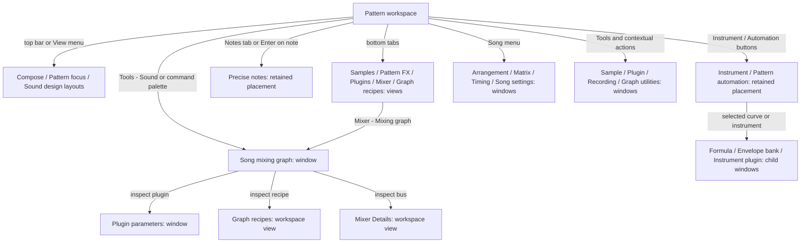
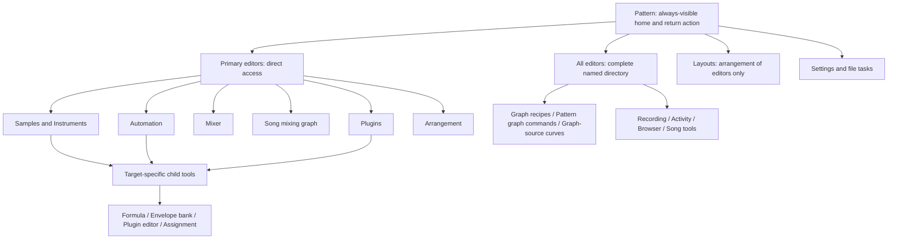

# ScreamSeq navigation map — review draft

**Purpose:** agree a coherent navigation structure with the musician before rearranging the UI. Pattern is the centrepiece. This document maps the current Windows source, identifies ambiguous routes, and proposes a destination model. It is not an implemented redesign or a runtime qualification report.

Source inspected: local `28a04dd6c` (product `f7eeec1d6`), based on main `b98631b48`. Remote main was verified at `b98631b48` during this review. No product changes, builds or tests were made for this map. The earlier live QA supplies examples of existing layouts, not exhaustive navigation evidence. Mac navigation itself has not been exhaustively remapped here; apply the same information architecture through native Mac controls only after checking its current routes.

## Read this first

The **song mixing graph is directly reachable today**, without opening the mixer first:

- Pattern workspace → **Tools → Sound → Mixing graph — routing, effects, groups and returns**.
- Pattern workspace → **Ctrl+K** → search **Mixing graph**.
- The more visible indirect route is **Mixer → Mixing graph…**.

All three dispatch `mixerRouting` to `openSongRouting()` and open the same separate `SongRoutingWindow`. The problem is discoverability and ambiguous naming, not an absent command.

There are three distinct things currently described as graphs:

| Destination | What it edits | Current surface |
|---|---|---|
| **Song mixing graph** | Channels, instruments, buses, sends, inserts and plugin audio routes | Separate window titled “Mixing graph” |
| **Graph recipes** | A reusable processing/modulation graph, with its own nodes and wires | Main workspace's Graph view |
| **Pattern graph commands** | Pattern-timed graph start/stop/amount commands and lanes | Separate editor, plus lanes in the pattern |

“Graph workflows” is a fourth entry: a multi-page utility for groups, sources, modulation, presentation and signal inspection. A graph-source curve is another editor. These should never be shortened to indistinguishable “Graph” launchers.

## Current map: the main routes

Arrows describe navigation, not signal flow. **View** means an existing workspace region changes; **window** means a separate native window; **retained placement** means the same command can dock or float depending on previous configuration.

This is the overview; the complete destination inventory below covers the less prominent children and utility dialogs.

## Proposed map: Pattern remains the anchor

This is a proposal, **not current behavior**. “Primary editor” is a musical destination, not a promise that its current Windows class already supports docking.

### Interaction contract to review

1. **One musical destination, explicit placement.** Primary editor selection shows/focuses its workspace panel. A distinct **Open in separate window** action floats that same retained editor. It never creates a second conflicting draft. Until a destination supports docking, label its direct entry **“Song mixing graph — window”** rather than pretending it is a workspace tab.
2. **Pattern stays reachable and normally visible.** Opening another editor uses the adjacent/bottom region, preserving pattern position, selection and playback. At compact sizes an explicit editor tab can replace the visible panel; Pattern stays on the tab strip. A dedicated **Back to Pattern** action focuses the retained pattern without stopping playback or applying a layout preset. Current Escape also participates in Stop and is not an adequate substitute.
3. **Separate three kinds of navigation.** Editor tabs/selectors change a local region; window launchers explicitly say they open a separate window; layout presets rearrange the whole workspace. Put these in visibly separate groups. Ellipsis means further interaction, not “new window,” and cannot serve as the sole placement signal.
4. **Direct access for major destinations.** Mixer, Song mixing graph, Plugins, Instruments, Samples, Automation and Arrangement must be reachable from Pattern without entering another editor first. Keep a compact primary editor strip/selector plus a complete **All editors** menu; use an overflow menu at narrow widths instead of hiding essential commands. The exact number of permanently visible shortcuts is a review decision.
5. **Keep object-specific tools contextual.** Formula editing needs a point; instrument assignment needs an instrument; vendor UI needs a plugin. Their directory entries can explain the requirement and offer a target chooser where appropriate. They must not silently guess a target or discard another editor's draft. A global directory need not turn every child into a global singleton.
6. **Show location and target separately.** Examples: “Song mixing graph,” “Graph recipe: Parallel texture,” “Pattern automation: P0 · Gainer · Gain.” Pin/follow state remains explicit. In graph inspection, provide “Show recipe in workspace,” “Open parameters window,” and “Show bus in Mixer” rather than a single ambiguous Open.
7. **Return is explicit.** Back to Pattern is distinct from returning to the originating row, following the current cursor, and changing layouts. Contextual children provide “Back to [parent]”; closing/hiding restores a valid prior focus. None of these actions implicitly commits unfinished musical edits.
8. **Placement memory must not contradict the label.** “Show in panel” docks even if last floated; “Open in window” floats even if last docked. A generic “Reveal existing editor” may honor remembered placement, but its menu label/indicator must state that destination before activation.

## Complete current destination inventory

Routes below are source-confirmed entry points, not a claim that every route is comfortable or freshly tested. `Palette → …` means Ctrl+K followed by the listed command words. Default shortcuts can be customized. **R** = retained dock/float editor; **V** = workspace view/page; **W** = separate native window; **D** = task dialog/chooser; **L** = whole-workspace layout. Child tools remain connected to their parent target.

### Pattern, arrangement and song

| ID | Destination / internal pages | Route from Pattern today | Effect and target | Source |
|---|---|---|---|---|
| N01 | Pattern grid and inline native FX fields | Central grid; View → Pattern focus; focus command in palette | V; layout preset and focus action are different operations | S1, S2, S4 |
| N02 | Read-only note inspector | Compose → right-hand Notes; Palette → Read-only note context | V; right inspector, pin/follow/Return | S2, S4 |
| N03 | Precise notes: Timeline, Hit, Tools, Details | Enter on note; bottom Notes; context Precise notes; Tools → Pattern → Precise note row editor | R; fresh preferred placement is secondary; button/tab can reveal retained placement | S2, S3, `PreciseNoteEditor.inc`, `PreciseNoteWindow.hpp` |
| N04 | Pattern FX / parameter bindings | Bottom Pattern FX; Enter on FX; Tools → Pattern → Inspect FX | V; lower editor, captured cell | `PatternEditor.inc`, S2 |
| N05 | Effect chooser | F4 in pattern; Tools → Pattern → Choose effect near cursor | W; near-cursor picker, selected cell | `EffectPickerIntegration.inc`, `EffectPickerWindow.hpp` |
| N06 | Pattern tools / transforms | Context Selection tools; Edit → Tools: preview transforms; palette | W; retained selection and preview | `PatternToolsIntegration.inc`, `PatternToolsWindow.hpp` |
| N07 | Pattern graph command lanes and editor | Pattern header Graphs…; Enter on graph lane; Tools → Pattern → Graph command editor; F6 graph-lane path | V lanes + W command editor; not the mixing graph | `GraphPatternLanes.inc`, `GraphCommandsWindow.hpp` |
| N08 | Scratch phrases: motion/fader and formula workbench | Pattern header Scratch phrases; Tools → Pattern → Scratch phrases | W; selected phrase/cell; formula is a child window | `ScratchGestureIntegration.inc`, `ScratchGestureWindow.hpp` |
| N09 | Arrange orders, sections and pattern details | Song → Arrange pattern orders; context Arrange patterns; palette Name selected section / Pattern name and notes | W; several modes of one retained owner | `SongTools.inc`, `ArrangementWindow.hpp` |
| N10 | Arrangement matrix / block copy | Song → Arrangement matrix and block copy; palette | W; order/channel block selection | `SongTools.inc`, `ArrangementMatrixWindow.hpp` |
| N11 | Tempo, meter and groove | Song → Tempo, meter and groove; context Tempo & groove | W | `SongTools.inc`, `SongTimingWindow.hpp` |
| N12 | Song title and channel count | Song → Title and channel count | W | `SongPropertiesIntegration.inc`, `SongPropertiesWindow.hpp` |
| N13 | New note track / Group note columns | Song → New note track / Group selected note columns | Two W instances/modes; different create/group targets | `NoteTrackPresentation.inc`, `NoteTrackWindow.hpp` |

### Samples and instruments

| ID | Destination / internal pages | Route from Pattern today | Effect and target | Source |
|---|---|---|---|---|
| N14 | Main sample waveform editor | Bottom Samples; Sound design layout | V; changes lower editor; Sound design also changes layout | `SampleEditor.inc`, S2, S4 |
| N15 | Sample and loop inspector | Right Sample & loops selector; Sound design | V; right-hand context, separate from N14 | S4, `WorkspaceDraw.inc` |
| N16 | Sample detail: Drawing, Process, Loops, Paste, Snap | Samples → Detail; Tools → Sound → Detailed waveform, drawing and crossfade | W; richer editor for selected sample, not a replacement page in N14 | `SampleDetailWindow.hpp`, `SampleDetailWorkflows.inc`, `Main.cpp` |
| N17 | Sample library / preview | Context Browse samples; Tools → Sound → Browse library | W; library search, preview and imports | `SampleLibrary.inc`, `SampleLibraryWindow.hpp` |
| N18 | Multi-sample instrument import/review | Sample library → family import | W child workflow; selected family/files and mapping | `SampleLibraryWindow.hpp`, `MultisampleImportWindow.hpp` |
| N19 | Audio sample import choosers | Tools → Sound → Import audio files; Ctrl+I; palette raw/mapped variants | D; subsequent import destination matters | `SampleEditor.inc`, `SampleFileDialog.hpp` |
| N20 | Sample/audio recorder | Tools → Sound → Record microphone or audio input; sample detail Record | W; retained take; opening is not permission to start capture | `SampleCaptureIntegration.inc`, `SampleRecordingWindow.hpp` |
| N21 | Render pattern selection / options | Pattern context Render selection; Tools → Pattern → Render selection options | W; captured pattern range, sample/instrument result; direct render commands can run without opening this form | `SampleCaptureIntegration.inc`, `PatternSampleRenderWindow.hpp` |
| N22 | Instrument: envelope, points, tools, properties, keymap | Top Instrument; Tools → Sound → Envelopes, settings and sample keymap | R; fresh preferred placement is float | `Main.cpp`, `InstrumentEnvelopeWindow.hpp`, S3 |
| N23 | Instrument plugin assignment | N22 → Plugin | W child; captured instrument; Add plugin opens library, rack button changes main workspace | `InstrumentEnvelopeWindow.hpp`, `InstrumentPluginWindow.hpp` |
| N24 | Instrument import chooser | Tools → Sound → Import ITI/XI/PAT/SFZ; N22 → Import | D reached through retained instrument owner | `InstrumentEnvelopeWindow.hpp`, S2 |
| N25 | Sample/instrument audition keyboard | Playback → Sample and instrument audition; sample/instrument editor Audition | W; chosen sound and audition target | `Main.cpp`, `AuditionWindow.hpp` |

### Mixing, plugins and graph editing

| ID | Destination / internal pages | Route from Pattern today | Effect and target | Source |
|---|---|---|---|---|
| N26 | Mixer: Strips / Details | Top Mixer; bottom Mixer; Tools → Sound → Open mixer controls and routing | V; strips are an embedded native owner, not a separate advertised window | `MixerEditor.inc`, `MixerStripsWindow.hpp` |
| N27 | **Song mixing graph**: Connections, Insert chain, Ordinary graph | Tools → Sound → Mixing graph; Palette → Mixing graph; N26 → Mixing graph | W; song routing; inspecting a node can open a parameter window or switch the main workspace to recipe/Mixer Details | `MixerEditor.inc::openSongRouting`, `SongRoutingWindow.hpp` |
| N28 | Graph recipes and modulation canvas | Bottom Graph; Tools → Sound → Reusable graph recipes and modulation | V; reusable graph selection, unrelated to N07's pattern command editor | `GraphEditor.inc`, `GraphCanvas.hpp` |
| N29 | Graph workflows: groups, processors/patching, song sources, modulation, frames/comments, reroutes, scope/listening, existing sources | Tools → Sound → Groups, modulation, visual layout and signal inspection; recipe context Groups & modulation | W with eight pages; links to graph-source curves, activity and source inspection | `GraphWorkflowIntegration.inc`, `GraphWorkflowWindow.hpp`, `GraphWorkflowActions.inc` |
| N30 | Audio port trims | Recipe context Audio port trims; Palette → Audio port trims | W; selected graph/port/source; no top-level Tools entry in current menu list | `GraphPatternLanes.inc`, `GraphTrimsWindow.hpp` |
| N31 | Plugin rack: parameters, programs, ports, assignments, presets | Bottom Plugins; Tools → Sound → Plugin rack; instrument assignment → rack | V; some pages then launch separate tools | `PluginEditor.inc` |
| N32 | Plugin library, favorites/categories | Tools → Sound → Browse library, favorites and categories; rack Browse; graph Add effect; instrument Add plugin | W; may carry bus/instrument destination | `PluginEditor.inc::openPluginLibrary`, `PluginLibraryWindow.hpp` |
| N33 | Paged plugin parameters | Mixing graph → inspect plugin; Graph recipes → All parameters | W per plugin or recipe node; up to ten parameter rows/page | `MixerEditor.inc::openGraphPluginParameters/openGraphRecipeParameters`, `PluginParametersWindow.hpp` |
| N34 | Vendor/built-in plugin editor | Rack → Editor; Palette → Open selected native editor; recipe plugin editor action | W, provider-owned; needs available plugin/node | `PluginEditor.inc`, `GraphEditor.inc`, native plugin host |
| N35 | Plugin instrument/MIDI assignments | Rack assignments page → Assigned instruments; context Instrument assignments; palette | W for selected plugin | `PluginEditor.inc::openPluginInstruments`, `PluginInstrumentsWindow.hpp` |
| N36 | Missing plugin/path repair | Rack or recipe Reconnect; corresponding palette commands | W; captured rack plugin or recipe node; scan/location choices | `PluginEditor.inc::openPluginPath`, `PluginPathWindow.hpp` |
| N37 | Plugin preset save/load/review | Rack preset page or recipe Save/Load preset | D/task flow; retained result review can precede chooser/retry | `PluginPresetIntegration.inc`, `GraphEditor.inc` |

### Automation and contextual children

| ID | Destination / internal pages | Route from Pattern today | Effect and target | Source |
|---|---|---|---|---|
| N38 | Pattern parameter automation: Target, Curve, Formula, Tools | Top Automation; Tools → Automation → Pattern parameter curves; rack Automate | R; fresh preferred placement float; selected pattern/plugin/parameter | `Main.cpp::openParameterAutomation`, `ParameterAutomationWindow.hpp`, S3 |
| N39 | Graph-source pattern curve | N28 select source → curve; N29 source → curve; Palette → Open selected source pattern curve | R; fresh preferred placement secondary; needs graph/song source plus pattern | `GraphCurveEditor.inc`, `GraphWorkflowIntegration.inc`, `GraphCurveWindow.hpp` |
| N40 | Song parameter automation / recorded points | Tools → Automation → Absolute song parameter lane; N38 → Song automation | W; absolute/song time, not pattern-relative curve | `Main.cpp::openAbsoluteAutomation`, `AbsoluteAutomationWindow.hpp` |
| N41 | Parameter activity: Sources, Recent changes, Recorded points | Tools → Automation → Effective parameter activity and sources; rack Activity; N29 sources | W; prepared processor/parameter selection; source navigation can open N38/N39/N40/N04 | `Main.cpp::openParameterActivity/inspectParameterSource`, `ParameterActivityWindow.hpp` |
| N42 | Formula workbench | Selected scripted point in N38/N39; scratch phrase; envelope-bank formula | W child; retains parent target, point and generation | `FormulaWorkbenchWindow.hpp`, `GraphCurveOwnerChildren.inc`, `ParameterAutomationWindow.hpp`, `ScratchGestureWindow.hpp` |
| N43 | Formula reference / guide | Tools → Automation → Formula reference; curve/bank Reference | W; reference-only mode of workbench; global reference does not require a graph target | `GraphCurveEditor.inc`, `FormulaWorkbenchWindow.hpp`, `EnvelopeBankWindow.hpp` |
| N44 | Envelope bank / linked templates / catalogue | Instrument envelope, pattern automation or graph curve → Envelope bank | W child, target-specific application; own curve and formula/reference children | `EnvelopeBankWindow.hpp`, `InstrumentEnvelopeWindow.hpp`, `GraphCurveOwnerChildren.inc`, `ParameterAutomationWindow.hpp` |

### Workspace, recording, settings and file tasks

| ID | Destination / internal pages | Route from Pattern today | Effect and target | Source |
|---|---|---|---|---|
| N45 | Compose / Pattern focus / Sound design / Connected / Graph editing | Top first three buttons; View menu; palette | L; change workspace arrangement; Connected and Graph editing available through View/palette | `WorkspaceLayouts.inc`, `WorkspaceDocking.inc`, S1 |
| N46 | Saved-layout manager | Top Layouts; View → Manage saved layouts; Ctrl+Alt+W | W; applying a preset then changes whole workspace | `WorkspaceLayoutWindow.hpp`, `WorkspaceLayouts.inc` |
| N47 | Command palette / command shortcut customization | Commands; Ctrl+K; View; Help keyboard commands | W; command directory includes routes not in menus; existing command IDs/bindings must survive redesign | `CommandPalette.hpp`, `WorkspaceShortcutDispatch.inc`, S1 |
| N48 | Audio settings | Top Audio settings; Tools → Preferences → Output device and buffer settings | W | `AudioSettings.inc`, `AudioSettingsWindow.hpp` |
| N49 | Musical keyboard settings | Tools → Preferences → Musical keyboard and Play-Stop key | W; distinct from command shortcut customization | `WorkspaceShortcutDispatch.inc`, `KeyboardSettingsWindow.hpp` |
| N50 | MIDI input and take review | Top MIDI; Playback → MIDI input and take review; palette | W; arming/take lifecycle, not a layout preset | `RecordingIntegration.inc`, `MidiRecordingWindow.hpp` |
| N51 | Recovery browser | Footer Recovery copies; File → Recover a song | W; restoring is a document-replacement action, not mere navigation | `RecoveryIntegration.inc`, `RecoveryWindow.hpp` |
| N52 | Project load/recovery report | File → Project load and recovery report; load-warning review | W; report and protected-source Save copy path | `DocumentLoadReportIntegration.inc`, `DocumentLoadReportWindow.hpp` |
| N53 | Module export and loss review | File → Export module | D; loss admission and export file choice; separate from native Save | `EditingView.inc::exportModuleFile`, `ModuleExportDialog.hpp` |
| N54 | Open / Save As / overwrite / unsaved-work review | File commands; Ctrl+O / Ctrl+Shift+S; New/Open/Close/recovery with retained work | D; preserve current draft/document on cancel; not ordinary editor destinations | `EditingView.inc`, `DocumentDepartureIntegration.inc`, S2 |
| N55 | About / command help | Tools → Help | D About; command help opens N47 | S1, S2 |

Inventory scope: all concrete `*Window.hpp` owners in `windows/App` are accounted for, including child-only owners and embedded MixerStrips; `NativeToolWindow` is infrastructure, not a destination. Native file helpers, the command palette, main workspace views and provider-owned editors are included separately. Internal state pages are grouped under their real owner rather than counted as independent windows. Individual confirmation/error popups are grouped with their task; this is a destination inventory, not a dump of every button or error string. Whole-song audio export is not added as an existing native destination without confirming its launcher; sample selection rendering is N21.

## Problems confirmed in source

| Finding | Evidence | Proposed correction |
|---|---|---|
| Toolbar mixes layouts, a workspace mixer switch and retained/floating editors | `WorkspaceView.inc::layoutControls` places Compose/Pattern focus/Sound design, Layouts, Mixer and Automation on one row; Instrument/settings/MIDI also share transport chrome | Distinct editor, layout and window groups; transport contains transport/input controls |
| A tab-looking Notes control can launch elsewhere | `WorkspaceLayouts.inc::selectDockTab(dockNotes)` dispatches `notesCommand`; `finishWorkspaceEditorOpen` honors retained placement | Tabs select a panel in their tab group; explicit float command owns window placement |
| Main Graph and header Graphs refer to different things | `graphCommand` vs `graphCommandsCommand` | Use Graph recipes versus Pattern graph commands; Mixing graph always names song routing |
| Recipe inspection from the mixing graph changes another surface | `MixerEditor.inc::openSongRouting` dispatches main recipe/Mixer Details but opens plugin parameters in a window | Destination-specific actions and visible location/target labels |
| Remembered placement is invisible on a generic launcher | Only automation, instruments, graphCurve and preciseNotes are registered retained dock/float editors in `WorkspaceDocking.inc` | Explicit placement commands and destination indication; do not claim every native tool already docks |
| “Notes” names both context and editing | Read-only right inspector and editable Precise Notes have separate state/owners | “Note inspector” vs “Precise notes”; consistently reserve each name |
| Settings/tools are scattered | Header, sidebar, Tools submenus, footer and child windows | One complete editor directory; local links remain shortcuts into the same owners |
| Global palette existence does not make a destination discoverable | Mixing graph and trims are searchable, but neither is obvious from its local label hierarchy | Named primary routes and useful unavailable/target-required explanations |
| Returning to Pattern has mixed semantics | Focus command hints Escape (also stops); View → Pattern focus changes layout; Return can navigate to opening position | Separate focus-only Pattern action, original-position Return and layout choice |

## Navigation sanity checks for implementation

- Every inventory ID has a documented global route or an intentional parent/target requirement. No important editor depends exclusively on a hidden child button.
- Opening a panel, opening a window and applying a layout are distinct commands. The visible label, accessible name, tooltip, palette entry and actual effect agree.
- Pattern → Mixing graph is direct; closing/hiding/revealing Pattern retains row, selection and playback. Inspect bus/recipe/plugin actions advertise their different destinations.
- A tab never unexpectedly creates a floating window. Repeated open/focus reuses the exact owner, raw text, caret, pin, target and pending completion; no duplicate draft.
- Back to Pattern neither stops transport nor changes follow mode. The previous layout and other editor drafts remain available.
- On narrow windows, all primary destinations remain in a visible selector/overflow menu. Keyboard traversal skips hidden controls; floating/docking restores valid focus.
- Children retain parent identity. Navigating to a different parameter or source cannot silently rebase a dirty draft. Recoverable refusal gives an explicit route to the retained editor.
- Maintain stable API panel identities, command IDs and saved-layout compatibility. Display labels can change without renaming persisted identifiers.
- Validate the source batch once: affected workspace/navigation/restore/draft/menu tests, then a single Windows candidate build and isolated keyboard/UI check. A new docking owner needs its own minimum-size, focus, close/reopen and saved-layout checks. Mac builds only when shared/native Mac code changes; final shared-main gate remains separate. Retain the one-build-per-hour limit.

## Implementation order after review

1. **Names and direct routes:** unify the destination catalogue; make Song mixing graph explicit and directly accessible; expose the complete directory; separate layouts from editor navigation. Preserve existing shortcuts and command handlers.
2. **Predictable placement and return:** explicit panel/window actions for the four existing dockable owners; repair tab semantics; add focus-only Pattern return and target/location labels. Reuse current draft/admission guards.
3. **Promote high-frequency windows:** assess Song mixing graph first for retained docking, then Arrangement and other frequently used tools. This is a real owner/layout migration, not a caption change; ship it in separate cohesive batches.
4. **Contextual child cleanup:** trace source → automation → formula/bank and instrument → plugin → library; consistent parent return and selection. Do not relocate every utility merely for symmetry.

The first two steps can improve discoverability before any large docking refactor. No implementation is started in this document-only review.

## Decisions for the musician

**Recommended:** treat the primary editors as adjacent workspace panels, with a separate explicit float action; retain utilities and target-specific workbenches as windows. Make **Song mixing graph** a primary destination alongside Mixer, never a child that must be discovered through Mixer.

Please review two things:

1. Is **Pattern, Samples, Instruments, Plugins, Mixer, Song mixing graph, Automation, Arrangement** the right primary set? Which should always be visible versus in the editor selector at smaller sizes?
2. Should the **Song mixing graph** normally open beside Pattern, with an option to float, or remain a separate window with a prominent direct launcher? I recommend beside Pattern once its native owner is safely dockable; the initial direct launcher can remain explicitly windowed.

No other user decision is needed to remove misleading names and make current placement explicit. The map leaves current product behavior unchanged for this review.

## Source key

Paths in tables are relative to `windows/App/` unless stated otherwise.

- **S1:** [WorkspaceCommands.inc](../../windows/App/WorkspaceCommands.inc), [WorkspaceMenuBar.inc](../../windows/App/WorkspaceMenuBar.inc): command catalogue and actual menu hierarchy.
- **S2:** [WorkspaceView.inc](../../windows/App/WorkspaceView.inc), [WorkspaceContextPanel.inc](../../windows/App/WorkspaceContextPanel.inc): visible launchers, contextual shortcuts and dispatch.
- **S3:** [WorkspaceDocking.inc](../../windows/App/WorkspaceDocking.inc), [WorkspaceLayouts.inc](../../windows/App/WorkspaceLayouts.inc): retained placement, tab selection and layout transitions.
- **S4:** [WorkspaceState.hpp](../../windows/App/WorkspaceState.hpp), [WorkspaceDraw.inc](../../windows/App/WorkspaceDraw.inc): right inspector and main workspace composition.
- [MixerEditor.inc](../../windows/App/MixerEditor.inc), [SongRoutingWindow.hpp](../../windows/App/SongRoutingWindow.hpp), [GraphWorkflowIntegration.inc](../../windows/App/GraphWorkflowIntegration.inc): routing/recipe/parameter cross-navigation.
- [Main.cpp](../../windows/App/Main.cpp): instrument/automation owner construction and parameter-source cross-navigation.

## Accepted implementation direction — 2026-10-21

The user approved this map and explicitly chose Song mixing graph beside Pattern,
with an option to float. The implementation batch adds `WorkspaceNavigation.inc`,
a fifth retained native owner (`mixingGraph`), editors preference V5 with V2–V4
migration, and a compact graph inspector. Pattern focus does not change transport,
selection or musical state. Layout choices and separate-window launchers have
separate toolbar menus. Additional editor destinations remain in All editors.

This is Windows presentation work: no shared musical schema, audio implementation,
Mac sources or project metadata changed. Validation receipts for the candidate
belong in `bin/navigation-20261021/`; do not infer completion from this paragraph.
The final report records checks actually performed and any remaining limits.
